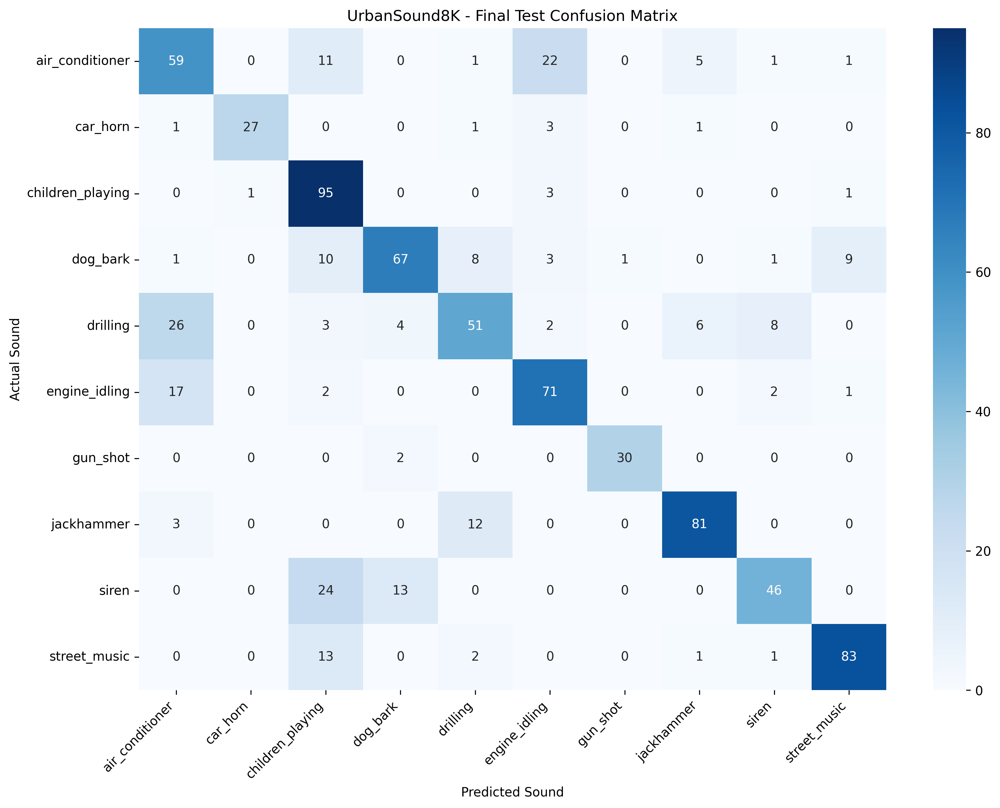

# UrbanSound8K Audio Classification Using Deep Learning

## Project Overview

This project uses deep learning to classify environmental
audio recordings into 10 urban sound categories.

The final neural network achieved **72.88% test accuracy**
on held-out UrbanSound8K fold 10.

## Dataset

- Dataset: UrbanSound8K
- Total recordings: 8,732
- Sound categories: 10
- Predefined folds: 10

### Sound Categories

1. Air Conditioner
2. Car Horn
3. Children Playing
4. Dog Bark
5. Drilling
6. Engine Idling
7. Gun Shot
8. Jackhammer
9. Siren
10. Street Music

## Technologies Used

Python, TensorFlow, Keras, Librosa, NumPy,
Scikit-learn, Matplotlib, Seaborn, and Google Colab.

## Feature Engineering

Each audio recording is converted into 86 features:

| Feature | Count |
|---|---:|
| MFCC means | 40 |
| MFCC standard deviations | 40 |
| Spectral centroid statistics | 2 |
| Zero-crossing rate statistics | 2 |
| RMS energy statistics | 2 |
| **Total** | **86** |

Features are standardized using a scaler fitted
only on the training data.

## Dataset Splitting

| Dataset | Folds | Recordings |
|---|---|---:|
| Training | 1-8 | 7,079 |
| Validation | 9 | 816 |
| Testing | 10 | 837 |

This experiment uses one predefined fold-based split,
not full 10-fold cross-validation.

## Model Comparison

| Model | Validation Accuracy |
|---|---:|
| Baseline MFCC model | 54.66% |
| Improved neural network | 59.44% |
| Rich-feature model | 68.63% |
| Regularized neural network | 70.71% |

## Final Model Architecture

- Input: 86 audio features
- Dense layer: 64 neurons
- Batch normalization
- Dropout: 0.5
- Dense layer: 32 neurons
- Batch normalization
- Dropout: 0.4
- Output: 10 classes with softmax
- L2 regularization: 0.005
- Adam optimizer

Training used early stopping, model checkpointing,
and learning-rate reduction.

## Final Test Results

| Metric | Result |
|---|---:|
| Validation accuracy | 70.71% |
| Test accuracy | 72.88% |
| Macro F1-score | 0.7520 |
| Weighted F1-score | 0.7270 |
| Test samples | 837 |

The original baseline achieved 56.75% test accuracy.

The final model improved test accuracy by
**16.13 percentage points** on the same held-out fold.

## Confusion Matrix

## Project Structure

- src/ : Feature extraction and prediction scripts
- models/ : Trained model and saved scaler
- results/ : Evaluation metrics and confusion matrices
- notebooks/ : Experiment notebook
- requirements.txt : Python dependencies
- README.md : Project documentation

## Installation

Install the required Python libraries:

    pip install -r requirements.txt

## Running Predictions

Classify an audio recording using:

    python src/predict.py path/to/audio.wav

The prediction script loads the trained model,
extracts 86 features, applies the saved scaler,
and predicts the audio category.

Example from a successful pipeline test:

    Actual sound: dog_bark
    Predicted sound: dog_bark
    Model probability: 89.67%

The displayed probability is a softmax score,
not a guaranteed measure of correctness.

## Key Findings

- Richer audio features improved validation accuracy.
- Regularization helped improve model performance.
- Some categories, including drilling and siren,
  remained challenging.
- Performance may vary across different dataset folds.

## Limitations

- Only one predefined test fold was evaluated.
- External recordings may produce different results.
- Full 10-fold cross-validation was not performed.
- Inference preprocessing must match training.
- Neural network training can produce slightly different
  results across runs due to randomness.

## Future Improvements

- Full 10-fold cross-validation
- CNN-based spectrogram classification
- Audio data augmentation
- External dataset evaluation
- Interactive prediction application

## Dataset Reference

UrbanSound8K:
https://urbansounddataset.weebly.com/urbansound8k.html

Hugging Face:
https://huggingface.co/datasets/danavery/urbansound8K

## Author

Machine Learning and Deep Learning Portfolio Project
